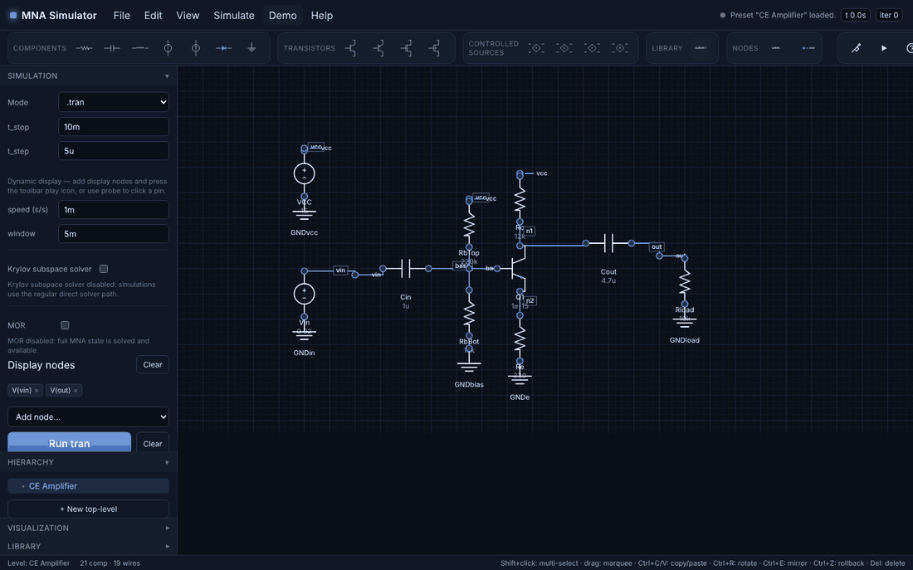
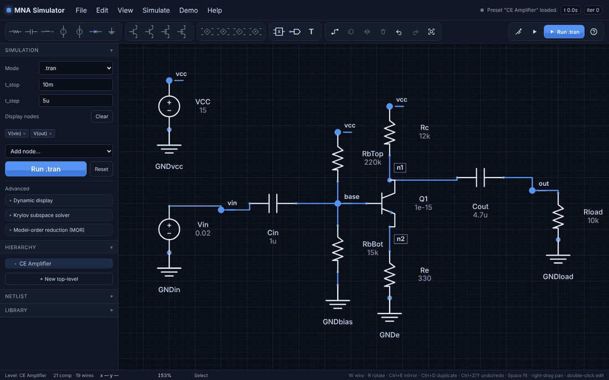
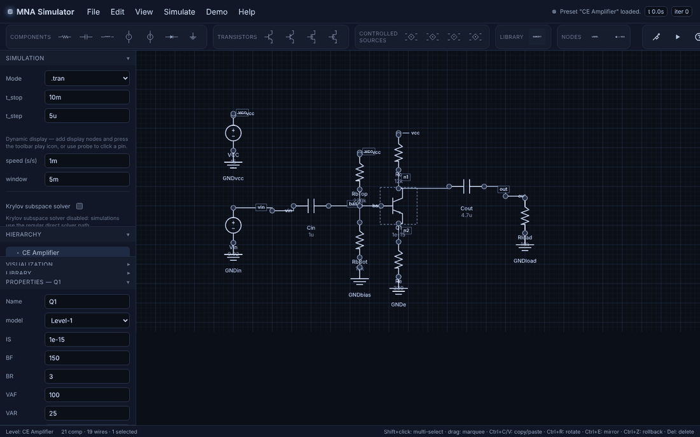
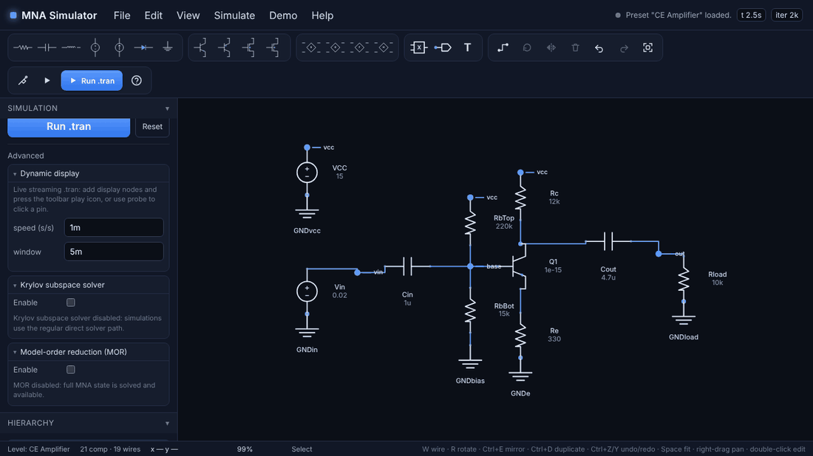

# Front End Design Audit

Audit of the React schematic editor in `app/web`, performed by driving the real
app in headless Chromium (Playwright, 1440×900, 1280×720 and 1024×700 viewports)
against the FastAPI backend, and by reading the front end sources. Each finding
lists its status after the accompanying change set.

The reference for "what a schematic capture tool should do" is LTspice, because
the user base of this project is likely to come from it. The third section is a
feature-by-feature comparison.

## 1. Findings from the visual audit

### Layout and structure

| # | Finding | Severity | Status |
| --- | --- | --- | --- |
| L1 | The schematic canvas only filled 75 % of its area (1160×580 in a 1160×772 cell). The `<canvas>` kept the default 2:1 aspect ratio because its wrapper had no height, leaving a dead band at the bottom that ignored clicks. | High | Fixed: wrapper fills the grid cell (`height: 100%`). |
| L2 | Left pane sections competed for height. With Properties open, the Hierarchy body overlapped the Visualization and Library headers; with Krylov + MOR open the Run button scrolled out of view. | High | Fixed: the pane scrolls as one column, sections size to content, headers are sticky. Run also moved to the toolbar. |
| L3 | Toolbar overflowed the viewport at 1440 px (1479 px wide) and clipped the Help button; at 1280 px half the groups were hidden. `overflow-x: auto` also clipped every tooltip. | High | Fixed: group labels removed, buttons 36 px, the bar wraps on narrow viewports, tooltips are visible. |
| L4 | File, Edit, View and Simulate menu buttons did nothing. | High | Fixed: all four menus work (see section 2). |
| L5 | The empty "Preset" select in the Simulation section had no options. | Medium | Removed (Demo menu is the single entry point). |
| L6 | Focusing the canvas drew a full-size white outline around it. | Low | Fixed: subtle inset focus ring. |
| L7 | "Display nodes" / "MOR outputs" captions rendered at 16 px while sibling labels were 12 px. | Low | Fixed with a shared `fieldLabel` style. |
| L8 | Advanced solver controls (dynamic display, Krylov, MOR) were always expanded above the primary Run action. | Medium | Reordered: Mode, parameters, display nodes and Run first; advanced blocks are collapsible. |

### Schematic rendering

| # | Finding | Severity | Status |
| --- | --- | --- | --- |
| R1 | Automatic net labels were drawn at every wire midpoint more than 90 px apart, so `vcc`, `gnd`, `mix`, `env` appeared many times and collided with NODE markers and part values. In the SRAM demo they covered the drawing. | High | Fixed: nets named by a NODE marker are not auto-labelled; anonymous nets (`n1`, `n2`) are labelled once, placed clear of the wire, and drawn above components. View > Show auto net names toggles them. |
| R2 | No junction dots at T-connections, so nets that join on a wire were indistinguishable from wires that merely cross. | High | Fixed: solid dot wherever three or more connections meet, computed from the same connectivity census the backend uses. |
| R3 | Every pin was drawn as a ring, connected or not, so open pins were invisible among the clutter. | Medium | Fixed: wired pins are a faint dot, unconnected pins an amber hollow square, dangling wire ends an amber ring. |
| R4 | Part captions for vertical resistors and transistors were printed through the wire below the body (`Rc 12k`, `Q1 1e-15`). | Medium | Fixed: captions go beside vertical two-terminal parts and transistors. |
| R5 | SUBCKT blocks showed pins as anonymous circles; the port names were only visible in Properties. The name was printed twice (inside and under the box). | Medium | Fixed: pin names printed inside the body next to each pin; duplicate caption removed. |
| R6 | NODE marker text ran along the wire it was attached to. | Low | Fixed: text sits above-right of the flag. |
| R7 | Toolbar glyphs for LABEL, NODE and SUBCKT were unreadable (scaled-down text). | Low | Fixed: dedicated palette glyphs. |
| R8 | Wire hit-testing assumed the horizontal-first route even when the renderer chose vertical-first, so clicks on some wires missed. | Medium | Fixed: one routing function feeds both drawing and hit-testing. |

### Result tiles

| # | Finding | Severity | Status |
| --- | --- | --- | --- |
| P1 | The x-axis caption ("time (s)") was drawn over the tick labels. | Medium | Fixed: explicit baselines and bottom padding. |
| P2 | Tick labels used raw floats and exponents (`0.001`, `2.0e-8`, `-2.8e-17`). | Medium | Fixed: engineering notation (`1m`, `20n`) with floating-point noise rounded to `0`. |
| P3 | Legend text sat directly on the traces. | Low | Fixed: translucent legend backing. |
| P4 | `.ac` results show magnitude only; phase is not returned by the backend. | Medium | Open (backend: `SpectrumResult` has no phase array). |

### Interaction and workflow

| # | Finding | Severity | Status |
| --- | --- | --- | --- |
| I1 | Wires could only start from a pin; there was no way to tap into an existing wire, and every wire was a fixed two-segment elbow. | High | Fixed: wire tool (`W` / `F3`) with multi-segment routing and real T-junction splits. |
| I2 | No redo; "rollback" only. | Medium | Fixed: redo stack (`Ctrl+Y`, `Shift+F9`), Edit menu and toolbar buttons. |
| I3 | No way to save or load a schematic, or export the netlist. | High | Fixed: File menu (JSON workspace save/open, `.cir` export). |
| I4 | No zoom-to-fit, zoom in/out or 100 % view; large demos loaded off-screen. | Medium | Fixed: Space / Ctrl+0 / View menu; demos zoom to fit when loaded. |
| I5 | Panning required a middle mouse button. | Medium | Fixed: right-drag pans (context menu suppressed). |
| I6 | Placement was one-shot and the ghost could not be rotated. | Medium | Fixed: sticky placement with `R`/`E` on the cursor part, Esc or right-click to finish. |
| I7 | Hover badge showed only `Q1.b`; the net name was not visible anywhere. | Low | Fixed: badge shows pin and net (or "unconnected"). |
| I8 | No cursor coordinates or zoom level readout. | Low | Fixed in the status bar. |
| I9 | Double-click on a part did nothing. | Low | Fixed: opens and focuses Properties. |
| I10 | Canvas and window keyboard handlers both acted on Delete, producing two undo entries. | Low | Fixed: the canvas consumes the keys it handles. |

### Engineering hygiene

| # | Finding | Severity | Status |
| --- | --- | --- | --- |
| E1 | `tsc --noEmit` reported 19 errors (metadata typing in `LeftPane.tsx`, duplicate `view` key in `App.tsx`). Vite does not type-check, so these shipped silently. | Medium | Fixed; typecheck is clean. |
| E2 | Dynamic display (`.dyn`) failed with HTTP 404 on the websocket because `pyproject.toml` pinned plain `uvicorn`, which has no websocket implementation. | High | Fixed: `uvicorn[standard]` dependency. |
| E3 | The open-pin validation error named the internal component id (`r-6-7k12w`) instead of the part name. | Low | Fixed: uses the part name. |
| E4 | `app/web/node_modules` (2 428 files, Windows-only native binaries) and `app/web/dist` are committed; there was no `.gitignore`, so `__pycache__` and Vite caches showed up as untracked noise. | Medium | Partially: `.gitignore` added for caches. Untracking `node_modules` is recommended but left as a separate decision. |
| E5 | `AnalysisPanel.tsx` is a dead re-export kept "for legacy imports" with no importers. | Low | Open (safe to delete). |

## 2. What changed in the UI

- **Menus.** File (new, open, save, export netlist), Edit (undo, redo, copy, paste, duplicate, delete, select all, rotate, mirror, wire tool, net label), View (zoom in/out/fit/100 %, grid, auto net names, close tiles) and Simulate (run each analysis, run current, dynamic display, probe, reset) are live, show shortcuts, and disable items that do not apply.
- **Toolbar.** Compact device palette, an edit group (wire, rotate, mirror, delete, undo, redo, fit) and a simulate group (probe, dynamic display, **Run**, help). Wraps on narrow viewports.
- **Canvas.** Junction dots, open-pin markers, dangling-end markers, de-cluttered net labels, SUBCKT pin names, wire tool with corners and T-splits, sticky placement with rotate/mirror on the cursor, right-drag pan, zoom-to-fit, arrow-key nudge, double-click to Properties, cursor and zoom readouts.
- **Left pane.** Scrolls as one column; primary controls first; advanced solver options in collapsible blocks; Properties opens and focuses on double-click.
- **Plots.** Engineering-notation ticks, no label collisions, legend backing.

## 3. LTspice schematic functions vs. this project

| LTspice function | Status here |
| --- | --- |
| Place component (F2), repeated placement until Esc | Done (toolbar palette, sticky placement) |
| Rotate / mirror while placing (Ctrl+R / Ctrl+E) | Done (`R` / `E` and Ctrl variants on the cursor part) |
| Wire mode (F3): start anywhere, click for corners, click wire to tap | Done (`W` / `F3`, splits wires at the tap point) |
| Net label (F4) | Done (`NODE` marker, `F4`) |
| Delete (F5) | Done (Del / Backspace, toolbar, Edit menu) |
| Duplicate (F6) | Done (`Ctrl+D`, `F6`) |
| Move (F7) / Drag with rubber-band wires (F8) | Done as one gesture: dragging a part keeps pin-anchored wires attached; selected free wire ends move with the selection |
| Undo / redo (F9 / Shift+F9) | Done |
| Zoom to fit (Space), zoom in/out, pan | Done (Space / Ctrl+0, Ctrl + = / −, right-drag or middle-drag) |
| Junction dots and open-pin squares | Done |
| Ground symbol, text comment | Done (`GND`, `LABEL`) |
| Component attribute editor (Ctrl+right-click) | Done as the Properties pane; double-click opens it |
| SPICE directive on the sheet (`.tran`, `.ac` text) | Partial: directives are edited in the Simulation section, not as sheet text |
| Save / open schematic (`.asc`) | Done as a JSON workspace (own format, not `.asc`) |
| Export / view netlist | Done (Netlist section, File > Export `.cir`) |
| Import a netlist into a schematic | Not available (netlist mode runs raw text instead) |
| Probe node / branch after a run to plot it | Partial: "Display nodes" picker and live probe tiles; no click-to-add-trace on finished `.tran` tiles |
| Waveform viewer with cursors, zoom, dB/phase | Partial: static tiles, engineering axes, no cursors; `.ac` phase missing (backend) |
| `.dc` sweep, `.noise`, `.step`, `.meas`, `.param` | Not available (parser accepts `.op`/`.dc` as operating point only) |
| Model library browsing (`.model`, `.lib`) | Not available; devices are Level-1 / small-signal with inline parameters |
| Hierarchy: create symbol from sheet, descend/ascend | Partial: hierarchy tree with SUBCKT instances and child levels; no "descend into instance" from the canvas |
| Light theme / configurable colours | Not available (dark only) |

### Suggested next steps (not done here)

1. Return phase in `.ac` results and draw a magnitude/phase pair, like LTspice's Bode view.
2. Click-to-probe on finished `.tran` tiles and waveform cursors with readouts.
3. `.dc` sweep and `.step` support end to end (parser, solver, tile).
4. Descend into a SUBCKT instance by double-clicking its body.
5. Optional light theme via the existing CSS tokens.
6. Untrack `app/web/node_modules` and `app/web/dist` and rely on `npm ci` / `npm run build` (the committed binaries are Windows-only and broke the Linux build until `npm install` re-added the native packages).

## 4. Before and after

| Before | After |
| --- | --- |
|  |  |
|  |  |

Before: repeated `vcc` labels, `n1`/`n2` boxes over part values, rings on every
pin, no junction dots, the canvas stopping 190 px short of the status bar, and
section headers overlapping in the left pane. After: one label per anonymous
net, junction dots, open-pin squares, captions beside vertical parts, a
full-height canvas, and a scrolling left pane with the toolbar wrapping on
narrow viewports.

## 5. How the audit was run

```bash
python -m pip install -e ".[dev]"
python -m uvicorn app.server.main:app --host 127.0.0.1 --port 8010
cd app/web && npm install && npx vite --port 5173
# Playwright (Chromium) script loads demos, places parts, draws wires, runs
# .op/.tran/.ac/.hb, starts the dynamic display, opens every menu and
# captures screenshots at three viewport sizes.
```

Verification after the changes: `tsc --noEmit` clean, `vite build` clean,
`pytest` 82 passed, and the same Playwright pass with zero console errors.
